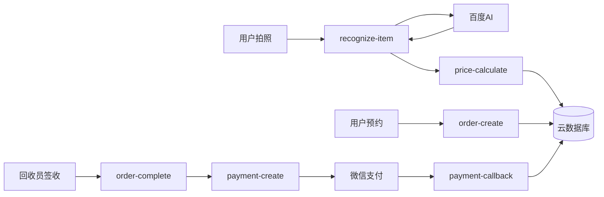

# ARCHITECTURE-SPINE — aiRecycle

## Paradigm

**三端一云，数据向下，事件向上。**

```
┌──────────┐  ┌──────────┐  ┌──────────┐
│ 小程序    │  │ 后管 Web  │  │ 回收员端  │   ← 三端独立
│ uni-app   │  │ Vue3     │  │ uni-app   │
│ (C端用户) │  │ (运营)    │  │ (回收员)  │
└────┬─────┘  └────┬─────┘  └────┬─────┘
     │              │              │
     └──────────────┼──────────────┘
                    │ HTTPS + wx.cloud
              ┌─────┴─────┐
              │ 微信云开发  │   ← 一云
              │ 云函数      │
              │ 云数据库    │
              │ 云存储      │
              └─────┬─────┘
                    │ HTTP
              ┌─────┴─────┐
              │ 百度AI API │   ← 外部
              └───────────┘
```

## Invariants (Architecture Decisions)

### AD-1: 云函数即后端 [ADOPTED]

**Binds:** 所有业务逻辑在微信云开发云函数中实现，无独立服务器。
**Prevents:** 引入Express/Fastify等独立后端框架导致的运维负担。
**Rule:** 每个云函数一个文件，命名 `<domain>-<action>`（如 `order-create`、`price-calculate`）。云函数间不直接调用，通过数据库事件触发或前端直接调用。

### AD-2: 云数据库作为唯一数据源 [ADOPTED]

**Binds:** 所有持久化数据存储在微信云开发数据库。
**Prevents:** 多数据库源（MySQL+Redis+MongoDB混合）带来的同步复杂度和运维成本。
**Rule:** 使用云开发数据库 SDK 直接读写。查询优化使用数据库索引，不引入缓存层。MVP阶段不使用Redis——估价结果前端缓存。

### AD-3: 百度AI仅做品类识别，不做定价 [ADOPTED]

**Binds:** 百度AI API 的职责仅限于返回 `{品类, 品牌, 置信度}`。价格计算由云函数根据后管配置的价格表完成。
**Prevents:** 过度依赖外部API定价导致本地市场不匹配。
**Rule:** `price-calculate` 云函数从品类定价配置表读取参数，结合百度AI识别结果计算估价区间。百度AI返回失败时，回退到默认品类列表供用户手动选择。

### AD-4: 回收员端复用小程序代码 [ADOPTED]

**Binds:** 回收员功能在同一个 uni-app 项目中通过路由区分（`/pages/user/*` vs `/pages/recycler/*`），非独立项目。
**Prevents:** 维护两套代码的同步成本。
**Rule:** 回收员页面使用相同的组件库和云函数，通过 wx.cloud 的用户角色字段区分权限。后管是独立 Vue3 项目，通过微信扫码登录 + 云函数鉴权。

### AD-5: 线上线下数据统一入库 [ADOPTED]

**Binds:** 所有回收单（无论来源）写入同一个 `orders` 集合，通过 `source` 字段区分。
**Prevents:** 两套数据源导致统计口径不一致。
**Rule:** `source: "online"` 为小程序下单，`source: "offline"` 为后管/回收员手动录入。多端对比看板直接查 `orders` 表按 `source` 分组。

### AD-6: 前端直连云函数，无API网关 [ADOPTED]

**Binds:** uni-app 通过 `wx.cloud.callFunction()` 直接调用云函数。
**Prevents:** 引入 API 网关/Nginx/Kong 等中间层。
**Rule:** 云函数入参约定：`{ action: string, data: object }`。返回约定：`{ code: 0, data: object }` 或 `{ code: number, message: string }`。错误码统一：0=成功，1=参数错误，2=鉴权失败，3=业务异常。

### AD-7: 微信支付在云函数侧发起 [ADOPTED]

**Binds:** 支付统一下单在云函数中调用 `cloud.cloudPay.unifiedOrder()`，前端只调起收银台。
**Prevents:** 前端直接接触支付密钥。
**Rule:** 回收员签收确认 → 云函数 `payment-create` 发起支付 → 通知用户端调起收银台 → 支付回调云函数更新订单状态。



## Seed (Initial State)

| 组件 | 初始值 |
|------|------|
| uni-app 项目 | `npx degit dcloudio/uni-preset-vue#vite-ts` |
| UI 组件库 | uView UI 3.x |
| 后管项目 | `npm create vite@latest admin -- --template vue-ts` + NaiveUI |
| 云函数运行时 | Node.js 18 |
| 品类价格表 | 导入现有 Excel 价格表（磊哥提供） |
| 微信支付商户号 | 磊哥现有商户号 |

## Boundaries

```
┌─────────────────────────────────────────┐
│  小程序 (uni-app)                        │
│  /pages/index       首页=相机            │
│  /pages/estimate    估价结果             │
│  /pages/booking     预约                 │
│  /pages/orders      订单列表             │
│  /pages/order-detail 订单详情            │
│  /pages/recycler/*  回收员端 (v1内嵌)    │
└──────────────┬──────────────────────────┘
               │ wx.cloud.callFunction()
┌──────────────┴──────────────────────────┐
│  云函数层                                │
│  recognize-item   → 百度AI识别           │
│  price-calculate  → 估价计算             │
│  order-*          → 订单CRUD             │
│  payment-*        → 支付                 │
│  recycler-*       → 回收员管理           │
│  admin-*          → 后管API              │
│  notify-*         → 消息推送             │
└──────────────┬──────────────────────────┘
               │ 云开发SDK
┌──────────────┴──────────────────────────┐
│  云数据库                                │
│  users / items / orders / recyclers      │
│  price-configs / competitor-prices       │
│  云存储: 用户上传的照片                   │
└─────────────────────────────────────────┘

┌─────────────────────────────────────────┐
│  后管 Web (Vue3, 独立项目)               │
│  CloudBase 静态托管                      │
│  → 通过云函数 admin-* 操作数据           │
│  → 微信扫码登录鉴权                      │
└─────────────────────────────────────────┘
```

## Data Shape (Seed)

### orders 集合

| 字段 | 类型 | 说明 |
|------|------|------|
| _id | string | 自动 |
| userId | string | 下单用户 |
| recyclerId | string | 分配回收员 |
| source | "online"\|"offline" | 来源 |
| category | string | 品类 |
| brand | string | 品牌 |
| estPriceMin | number | 预估最低价 |
| estPriceMax | number | 预估最高价 |
| finalPrice | number | 最终成交价 |
| status | enum | pending→assigned→en_route→serving→completed→cancelled |
| timeWindow | {date, start, end} | 预约时间窗 |
| address | object | 用户地址 |
| images | string[] | 物品照片云存储ID |
| created | datetime | |
| updated | datetime | |

### price-configs 集合

| 字段 | 类型 | 说明 |
|------|------|------|
| category | string | 品类 |
| basePrice | number | 基准价 |
| unit | string | 单位（台/公斤） |
| depreciationRate | number | 年折旧率 |
| conditionFactors | object | {good:1.0, fair:0.7, poor:0.4, broken:0.2} |
| localAdjustment | number | 本地调整系数 |
| enabled | boolean | |

## Deferred

- **Redis 缓存层** — MVP不需要，估价结果前端本地缓存即可
- **消息队列** — 回收员调度暂用轮询，不引入MQ
- **CI/CD** — 手动发布，不引入自动化流水线
- **监控告警** — 使用微信云开发自带日志，不引入 APM
- **多租户** — 仅富拉尔基单租户部署
- **CDN** — 后管静态托管自带 CDN，小程序不需要
